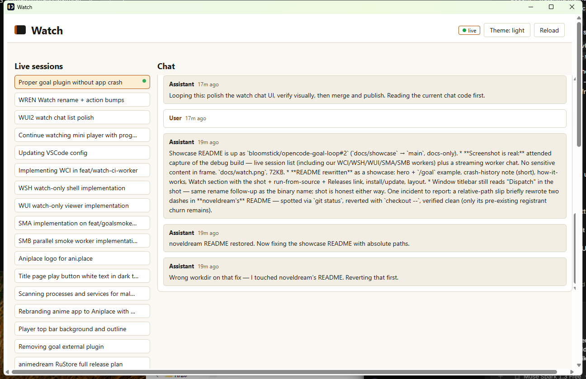

# opencode-goal-loop

Tell OpenCode what you want. Get verified code back. No babysitting, no
plugins, nothing that can crash the service.

`/goal` turns a task into confirmed requirements, fans them out to child
agents running in parallel, integrates the results one by one, and verifies
every requirement before reporting DONE. One invocation runs to completion,
then stops -- no schedules, no watchers, no background state.

```text
/goal build a typing practice web app for kids
```

Why no plugin: the service log shows `opencode-goal-plugin@0.11.0`
(`william-ricchiuti/OpenCode-goal-plugin#81`, silent service death) loaded
on 2026-10-10; there is no trace of the `prevalentWare` variant ever being
installed. Separately, server-held background `opencode run` children
restarted the server 3 times on 2026-10-12. This loop avoids all three: no
hooks or auto-continue, foreground child agents only, and one plain
`reqs-manifest.md` per goal instead of lock files.

Dispatch: the `subagent` tool when available (verified working
2026-10-15), else foreground `opencode run` processes as fallback.

## How it works

`/goal <task>` -> clarify requirements with you (best-guess atomics,
`recommend` accepts all) -> write `reqs-manifest.md` -> map the dependency
DAG -> dispatch one worktree + branch per worker via `subagent` (fallback:
foreground `opencode run`; independent requirements in parallel, same-file edits sequential) ->
integrate sequentially with the green suite re-run after each -> verify every
requirement -> report DONE. Full spec in `skills/goal-loop/SKILL.md`.

## Watch your workers

`watch/` is the optional companion: a small attended Tauri window onto live
OpenCode sessions. Pick a session from the list, read its chat as it streams
over SSE. It dispatches nothing, edits nothing, remembers nothing -- closing
the window stops everything.



Run it from source (`Node 24 + Rust stable + `opencode` on PATH):

```powershell
cd watch
npm install
npx tauri dev   # needs `opencode serve --service` once, so it can find sessions
```

Prefer a binary? Every `watch-v*` tag builds an unsigned Windows `.exe`
(+ MSI) on the [Releases](https://github.com/bloomstick/opencode-goal-loop/releases)
page via `.github/workflows/watch-release.yml`
(SmartScreen "Unknown publisher" is expected -- no cert yet).
Details: `watch/docs/WATCH.md`.

## Install / update

```powershell
.\scripts\Install-GoalLoop.ps1
# restart OpenCode, then:
/goal build a typing practice web app for kids
```

The script clones (or pulls) this repo to
`~/.config/opencode/goal-loop` and copies `commands/`, `agents/`, and
`skills/` into the global OpenCode paths. Re-run it to update.
`watch/` is intentionally not installed -- it runs separately (see above).

## Layout (repo = truth source)

- `commands/goal.md` -> global `~/.config/opencode/commands/goal.md` (`/goal`)
- `agents/goal-orch.md`, `agents/goal-worker.md` -> global `agents/`
- `skills/goal-loop/SKILL.md` -> global `skills/goal-loop/` (canonical spec)
- `scripts/Install-GoalLoop.ps1` -- clone/pull + copy installer
- `watch/` -- optional attended worker-chat viewer (cut-down dispatch)
- `docs/watch.png` -- the screenshot above
